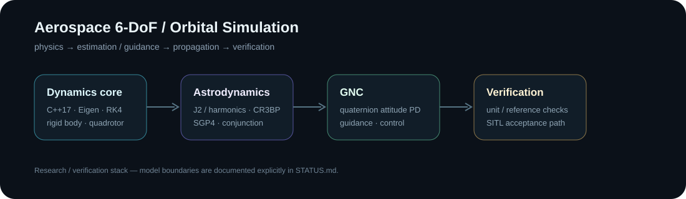

# Aerospace Lab — 6-DoF / Orbital Simulation

[](https://github.com/MatthewDavidGoodman/Portfolio/actions/workflows/aerospace-6dof.yml)

A research-oriented aerospace simulation stack built around a **C++17 / Eigen dynamics core** with Python astrodynamics and verification modules.



## What this demonstrates

- building and testing a numerical 6-DoF dynamics core rather than only scripting a simulator;
- quaternion attitude dynamics, RK4 integration and closed-loop attitude control;
- separating physical models, GNC, orbital analysis and validation boundaries;
- working across rigid-body flight simulation, astrodynamics, SGP4/TLE handling and conjunction research;
- documenting what is validated, experimental and explicitly *not* claimed.

## Core areas

- rigid-body 6-DoF dynamics with RK4 integration;
- quaternion attitude dynamics and PD control;
- quadrotor dynamics and motor lag;
- J2 / harmonic-gravity research modules;
- CR3BP and two-body dynamics;
- SGP4/TLE catalog handling;
- covariance and conjunction-analysis tooling;
- ArduPilot SITL acceptance path in the full working project.

## Reproduce the public C++ check

```bash
sudo apt-get install libeigen3-dev
cmake -S . -B build -DCMAKE_BUILD_TYPE=Release
cmake --build build -j
ctest --test-dir build --output-on-failure
```

CI runs the same portable C++ build and core test on Ubuntu.

## Engineering boundaries

This is **research and verification software**, not a flight-qualified digital twin or operational conjunction service. [STATUS.md](STATUS.md) distinguishes implemented/tested pieces from simplified or experimental models and explicitly unimplemented work.

Generated telemetry, large replay outputs, local build artifacts and interview-specific material are intentionally excluded from this public snapshot.
