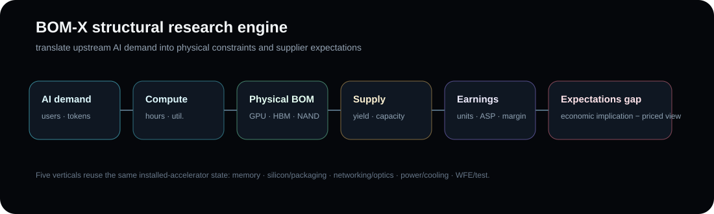

# BOM-X — AI / Semiconductor Research Engine

[](https://github.com/MatthewDavidGoodman/Portfolio/actions/workflows/bom-x.yml)

A self-contained research terminal that translates AI/software demand into **compute requirements, semiconductor BOM demand, physical supply constraints, supplier earnings and expectations gaps**.



## What this demonstrates

- converting an upstream software-demand thesis into falsifiable physical-unit assumptions;
- connecting compute demand to memory, silicon/packaging, networking/optics, power/cooling and WFE/test;
- exposing utilization, spare capacity, pricing, supplier-share and architecture assumptions rather than hiding them;
- enforcing event deduplication and point-in-time backtest discipline;
- combining semiconductor engineering intuition with quantitative equity-research structure.

## Core research chain

```text
AI software demand
      ↓
compute / accelerator-hours
      ↓
physical BOM
      ↓
capacity / yield / inventory
      ↓
supplier revenue / margin / EPS
      ↓
consensus / implied expectations
      ↓
research signal
```

## Run

Open [`index.html`](./index.html) in a modern browser. The application is self-contained: no backend or build step is required.

The terminal includes a demand backsolver, event library, memory/earnings, foundry/packaging, networking/optics, power/cooling, WFE/test, backtest and tactical-regime modules.

## Model-risk controls

- explicit utilization, reserve and spare-capacity assumptions;
- bounded price-response logic;
- canonical commitment IDs to reduce double counting;
- sensitivity views around economically important inputs;
- point-in-time expectations/backtest discipline;
- event-level clustering and multiple-testing awareness.

See [METHODOLOGY.md](./METHODOLOGY.md) for the research design.

## Status

This is a **research prototype**, not an investment recommendation or production forecasting system. Historical consensus, revision, factor-return and transaction-cost feeds remain separate data-engineering requirements; unavailable inputs are marked rather than fabricated.
