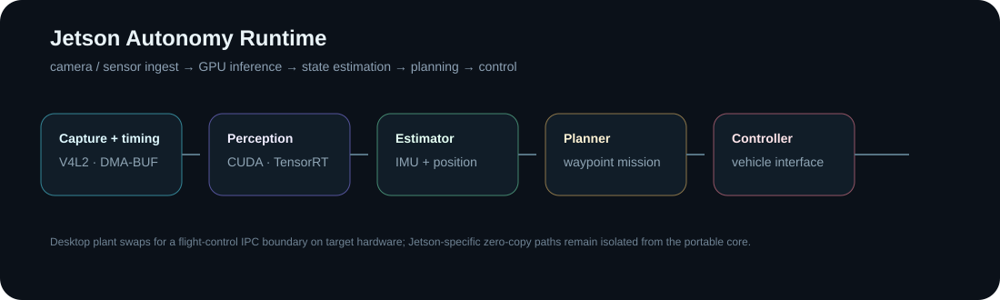

# Jetson Autonomy Simulator

[](https://github.com/MatthewDavidGoodman/Portfolio/actions/workflows/jetson-autonomy-sim.yml)

A C++ autonomy stack designed to bridge a **desktop 6-DoF simulation** and an **NVIDIA Jetson/Tegra mission-computer deployment**.



## What this demonstrates

- architecture that separates portable autonomy logic from target-specific Jetson plumbing;
- sensing → estimation → planning → control integration in C++;
- V4L2 streaming and DMA-BUF export scaffolding;
- CUDA preprocessing and TensorRT/GStreamer integration boundaries;
- awareness of BSP/device-tree, real-time scheduling, memory movement and deployment constraints.

The flight-control boundary is deliberate: Jetson can own high-bandwidth sensing, perception, localization, planning and inference while a lower-level controller retains deterministic actuator I/O and inner-loop safety.

## Portable build

```bash
cmake -S . -B build -DCMAKE_BUILD_TYPE=Release
cmake --build build -j
./build/autonomy_sim 20
./build/pipeline_bench
```

CI compiles and runs this CPU-only path on Ubuntu.

## Jetson path

Use the CUDA/TensorRT versions shipped with the target JetPack/L4T release.

```bash
cmake -S . -B build-jetson \
  -DCMAKE_BUILD_TYPE=Release \
  -DAUTONOMY_ENABLE_CUDA=ON \
  -DAUTONOMY_ENABLE_GSTREAMER=ON \
  -DAUTONOMY_ENABLE_TENSORRT=ON
cmake --build build-jetson -j$(nproc)
```

The intended camera path is:

```text
sensor → kernel/V4L2 → DMA-BUF/NVMM → CUDA preprocessing → TensorRT → compact detections
```

A copy-based appsink path is useful for bring-up but is not presented as the final zero-copy flight path.

## Embedded Linux

`deploy/` contains L4T, device-tree, kernel, Yocto and DeepStream scaffolding. `scripts/jetson_probe.sh` captures the target software/camera/power environment before deployment.

## Status

The portable CPU architecture is the reproducible public path. CUDA/TensorRT, carrier-board camera integration and hard real-time tuning depend on target hardware and are intentionally described as integration scaffolding rather than already flight-validated behavior.
