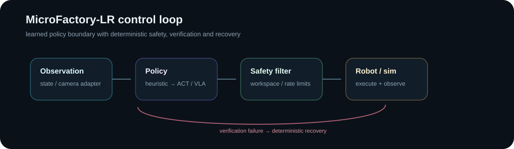

# MicroFactory-LR

[](https://github.com/MatthewDavidGoodman/Portfolio/actions/workflows/lerobot-microfactory.yml)

A simulation-first autonomous manufacturing cell built around one loop:

**observe → manipulate → verify → recover**



## What this demonstrates

- robot-learning code wrapped in deterministic safety and verification logic;
- explicit policy interfaces so a heuristic controller can later be replaced by ACT / VLA policies;
- recovery as a first-class control path rather than an afterthought;
- randomized evaluation with success, intervention and safety-projection metrics;
- testable robotics software before hardware is introduced.

## What works now

- 2-D pick/place simulator;
- closed-loop policy controller;
- deterministic action safety projection;
- grasp and placement verification;
- automatic grasp-recovery path;
- randomized scenarios and evaluation metrics;
- optional LeRobot compatibility boundary;
- unit tests.

## Reproduce

```bash
python -m venv .venv
source .venv/bin/activate
pip install -e '.[dev]'

pytest
microfactory demo
microfactory eval --episodes 100
```

The heuristic baseline uses privileged state on purpose. It proves the surrounding cell logic before learned perception/control is introduced. CI tests the simulator, safety filter and controller, then runs a randomized evaluation threshold.

## Roadmap

- **v0.1:** deterministic simulation, policy protocol, safety, verification, recovery, evaluation;
- **v0.2:** synthetic RGB + OpenCV visual state;
- **v0.3:** LeRobotDataset + ACT adapter;
- **v0.4:** physical arm, cameras, calibration and watchdog;
- **v0.5:** SmolVLA robustness study.
